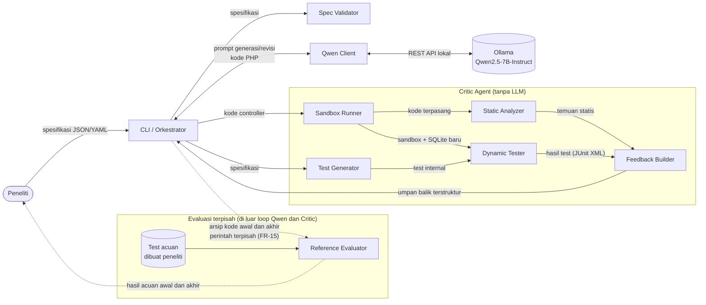

# PRD: Rancang Bangun Mekanisme Critic Agent untuk Self-Debugging pada Kode Program yang Dihasilkan oleh Qwen2.5-7B-Instruct

**Jenis dokumen:** Product Requirements Document (prototipe Tugas Akhir D-III)  
**Versi:** 1.3  
**Tanggal revisi:** 2 November 2026  
**Penulis:** Tim peneliti — Mikhael Josua Roganda; Johannes Christian Pratama Sitorus; Joys Lamlam Dominiq Christy Tampubolon (sesuai proposal)

**Dokumen acuan:** Proposal Tugas Akhir `Prop_TA_TA_2526_16_revisi6_FPR (5) (7).docx`, khususnya bagian Tujuan, Research Questions, Lingkup, Metodologi Penelitian, dan Risiko. PRD ini menerjemahkan proposal menjadi kebutuhan implementasi dan evaluasi. Pilihan teknis yang belum ditetapkan proposal dinyatakan sebagai keputusan implementasi atau parameter yang harus dibekukan sebelum evaluasi akhir.

**Catatan perubahan v1.3:**

- Menambahkan ablasi umpan balik spesifik versus generik dari kandidat awal yang sama, dengan anggaran maksimum dan kebijakan berhenti yang sama.
- Menetapkan uji pendahuluan suhu, seed, keragaman kandidat, biaya eksekusi, dan frekuensi penghentian `identical_code` sebelum pembekuan.
- Membekukan kontrak route/signature controller, header JSON, serta pemeriksaan kesiapan Laravel sebelum menilai kandidat.
- Memisahkan evaluasi komponen sintetis, keluaran Qwen asli, dan kasus di luar cakupan deteksi; analisis utama bersifat deskriptif dengan hitungan mentah.
- Memperjelas pembatasan proses PHP, penggunaan dependensi bersama yang bersyarat, tahapan MVP/evaluasi, peninjau, serta definisi operasional agent.
- Memusatkan kebijakan pelaporan pada bagian 12.8; diagram PRD tetap menjadi acuan pengganti Gambar 2 proposal.

**Riwayat versi:** v1.2 menyelaraskan istilah self-debugging, metrik deteksi, evaluasi kode awal/akhir, dan pembekuan eksperimen dengan proposal. v1.1 memperbaiki diagram arsitektur dan lokasi temuan dinamis.

## 1. Ringkasan

Prototipe ini adalah alat CLI berbasis Python bernama **Critic Agent**. Alat ini memverifikasi dan membantu memperbaiki kode fungsi CRUD *controller* Laravel yang dihasilkan oleh model bahasa lokal **Qwen2.5-7B-Instruct** (Ollama, kuantisasi 4-bit).

Critic Agent **tidak memakai LLM**. Ia bekerja dengan **analisis statis** dan **pengujian dinamis** di sandbox, lalu mengirim umpan balik terstruktur (lokasi, penjelasan, bukti) kepada Qwen untuk merevisi kode. Siklus berulang sampai kode lolos, batas 3 revisi tercapai, kode hasil revisi identik dengan kode sebelumnya, atau terjadi ERROR sistem.

Self-debugging didefinisikan sebagai pemeriksaan dan perbaikan kode secara otomatis tanpa intervensi manusia selama loop. Bukti pemeriksaan berasal dari alat eksternal; Qwen berperan sebagai pembangkit dan perevisi kode. Critic Agent sendiri tidak merevisi kode dengan LLM.

Yang dioptimasi adalah **kesesuaian kode terhadap spesifikasi**, bukan performa (kecepatan/memori). Evaluasi memisahkan ketepatan deteksi Critic, perubahan kode awal–akhir, dan perbedaan hasil umpan balik spesifik–generik. Status LOLOS hanya menyatakan lolos pemeriksaan internal, bukan jaminan lulus test acuan.

**Definisi operasional agent:** Critic adalah komponen otomatis berbasis aturan yang menerima kode dan spesifikasi, menjalankan alat pemeriksaan, menggabungkan bukti menjadi penilaian, lalu memilih temuan untuk umpan balik dalam loop yang dikelola orkestrator. Istilah agent tidak mengandaikan LLM, pembelajaran, atau perencanaan umum di dalam Critic. Analisis statis berfungsi sebagai pemeriksaan awal sintaks dan kontrak struktur; bukti kesesuaian perilaku terutama berasal dari test dinamis. Kontribusi yang dievaluasi adalah integrasi pemeriksaan dan umpan balik otomatis, bukan kebaruan algoritma analisis statis.

## 2. Masalah

- Model 7B terkuantisasi sering menghasilkan kode yang tampak benar tetapi menyimpang dari spesifikasi: validasi kurang, kode status salah, method tidak lengkap, atau sintaks/pemanggilan model keliru.
- Memeriksa kode secara manual lambat dan tidak konsisten.
- Jika Qwen disuruh menilai kodenya sendiri, hasil penilaian tidak dapat diandalkan dan tidak memberi bukti objektif.
- Dibutuhkan mekanisme verifikasi **deterministik dan dapat diulang** yang memberi umpan balik spesifik. Dugaan bahwa rincian umpan balik membantu revisi diuji melalui pembanding generik pada bagian 12.2; manfaat tersebut tidak diasumsikan sudah terbukti.

## 3. Tujuan dan Non-Tujuan

### 3.1 Tujuan

- **T1.** Membangun Critic Agent CLI yang memeriksa kode CRUD controller Laravel dari Qwen terhadap spesifikasi terstruktur.
- **T2.** Menghasilkan umpan balik yang spesifik (lokasi, penjelasan, bukti) agar Qwen dapat merevisi.
- **T3.** Menjalankan loop generate → periksa → revisi dengan generasi awal dan maksimal 3 iterasi revisi.
- **T4.** Mengukur perubahan kesesuaian kode awal dan akhir pada test acuan independen yang sama, termasuk perbaikan dan regresi.
- **T5.** Mengukur ketepatan deteksi Critic terhadap ground truth per contoh kode melalui precision, recall, dan FPR.
- **T6.** Membandingkan hasil revisi dengan umpan balik spesifik dan generik pada kandidat awal yang sama, sebagai analisis tambahan untuk memisahkan manfaat rincian umpan balik dari kesempatan revisi ulang.

T1–T3 mendukung RQ1 proposal tentang rancangan mekanisme dan umpan balik. T4 mendukung RQ2 tentang perubahan kesesuaian fungsional. T5 mendukung evaluasi komponen Critic secara terpisah dari evaluasi mekanisme self-debugging. T6 adalah penguatan rancangan evaluasi dalam PRD, bukan RQ baru atau perbandingan antarmodel.

### 3.2 Non-Tujuan (di luar lingkup)

- Antarmuka grafis (GUI).
- Autentikasi/otorisasi.
- Uji keamanan dan uji beban.
- Deployment.
- Fine-tuning model.
- Perbandingan antar model.
- Optimasi performa kode.
- Pembuatan route, model, migration, atau proyek dasar oleh Qwen (disiapkan peneliti).
- Penggunaan LLM di dalam Critic Agent.

## 4. Pengguna dan Skenario

**Pengguna utama:** peneliti (mahasiswa TA) yang menjalankan eksperimen. Pembimbing/penguji dapat melihat hasil lewat log dan riwayat.
\
| Skenario | Deskripsi |
| --- | --- |
| S1 – Kode lolos pada percobaan awal | Peneliti memasukkan spesifikasi `products`. Kode percobaan ke-0 tanpa temuan statis dan semua test internal lulus; status LOLOS, jumlah revisi 0. |
| S2 – Kode diperbaiki | Pemeriksaan pertama gagal (mis. `store` mengembalikan 200, seharusnya 201). Critic memberi umpan balik, Qwen merevisi, lolos di iterasi ke-2. |
| S3 – Batas revisi tercapai | Setelah revisi ke-3 masih ada temuan atau test gagal. Status BELUM LOLOS dengan alasan `max_revisions`; riwayat tersimpan. |
| S4 – Error sistem | Ollama tidak aktif atau sandbox gagal dijalankan. Status ERROR dengan pesan penyebab. |
| S5 – Evaluasi akhir | Setelah loop selesai, peneliti menjalankan evaluator terpisah pada kode awal dan akhir dengan test acuan identik serta kondisi awal data yang sama. |
| S6 – Kode tidak berubah | Revisi menghasilkan kode PHP identik dengan kandidat sebelumnya yang belum lolos. Berhenti dini dengan status BELUM LOLOS dan alasan `identical_code`. |
| S7 – Pengujian komponen | Peneliti menjalankan Critic pada korpus kode berlabel, lalu menghitung TP/FP/TN/FN dan precision, recall, FPR tanpa memanggil Qwen saat penilaian. |
| S8 – Pembanding umpan balik | Satu kandidat awal disalin ke kondisi spesifik dan generik; masing-masing menjalankan loop dengan batas maksimum 3 revisi dan aturan berhenti yang sama. |

## 5. Kebutuhan Fungsional

| ID | Kebutuhan | Tahap pemenuhan |
| --- | --- | --- |
| FR-01 | CLI menerima berkas spesifikasi terstruktur (JSON/YAML) sebagai input. | MVP (M1) |
| FR-02 | Critic memvalidasi spesifikasi (field wajib, tipe, kode status) sebelum proses dimulai; spesifikasi tidak valid ditolak dengan pesan jelas. | MVP (M1) |
| FR-03 | Sistem membangun *prompt* untuk Qwen dari spesifikasi dan memanggil Qwen2.5-7B-Instruct lokal lewat Ollama. | MVP (M1) |
| FR-04 | Qwen hanya diminta menulis satu berkas controller berisi fungsi CRUD (`index`, `store`, `show`, `update`, `destroy`). Sistem mengekstrak kode PHP dari respons. | MVP (M1) |
| FR-05 | Critic menyiapkan area kerja Laravel per run dan memasang controller Qwen. Route, model, migration, fixture, dan kontrak signature berasal dari paket tetap. Dependensi disiapkan menurut bagian 11.1; jangan menyalin seluruh vendor pada setiap revisi jika workspace bersih dapat dipulihkan secara terverifikasi. | MVP (M1) |
| FR-06 | Critic membuat ulang database SQLite pada setiap pengujian (migrasi dari nol). | MVP (M1) |
| FR-07 | Analisis statis memeriksa sintaks, namespace/class, kelima method publik, serta kontrak signature pada bagian 9.1.1. Tidak menilai semantik validasi, query, atau status HTTP; perilaku diperiksa secara dinamis (FR-09). | MVP (M1) |
| FR-08 | Critic membuat **test internal** secara otomatis dari template berdasarkan spesifikasi. | MVP (M1) |
| FR-09 | Critic menjalankan test internal di sandbox dan menguraikan hasilnya. Assertion memeriksa kode status, isi/struktur respons sesuai kontrak, perubahan data target, serta record lain pada kondisi sukses, input tidak valid, dan data tidak ditemukan (bagian 9.1 dan 12.1). | MVP (M1) |
| FR-10 | Critic menyusun umpan balik terstruktur per temuan: lokasi, penjelasan, bukti. | MVP (M1) |
| FR-11 | Sistem mengirim kode sebelumnya beserta umpan balik ke Qwen untuk revisi, lalu mengulang pemeriksaan. | MVP (M1) |
| FR-12 | Loop berhenti jika lolos, revisi ke-3 telah diperiksa dan masih gagal, kode revisi identik dengan kandidat sebelumnya, atau terjadi ERROR. Simpan status dan alasan berhenti yang berbeda (bagian 10). | MVP (M1) |
| FR-13 | Sistem menampilkan kode akhir, status (LOLOS / BELUM LOLOS / ERROR), dan ringkasan riwayat di CLI. | MVP (M1) |
| FR-14 | Sistem menyimpan kode awal, kandidat setiap percobaan, kode akhir, respons mentah model, seluruh temuan, hasil test, status pengujian termasuk yang dilewati, waktu, jumlah revisi, dan alasan berhenti. Umpan balik yang dipangkas untuk prompt tidak menghapus temuan dari log. | MVP (M1) |
| FR-15 | Sistem menyediakan perintah evaluasi terpisah untuk menguji **kode awal dan kode akhir** setiap eksekusi pada test acuan yang sama. Setiap versi diuji dari keadaan data awal yang sama. Test acuan dan hasilnya tidak tersedia bagi Qwen, pembuat test internal, atau penyusun umpan balik selama loop. | Evaluasi (M3) |
| FR-16 | Sistem wajib mencatat ID eksekusi, versi/hash prototipe, spesifikasi dan test, identitas/digest model, kuantisasi, prompt aktual, suhu, seed, panjang konteks, batas keluaran, timeout, dan konfigurasi lingkungan. Jika suatu parameter tidak didukung, catat secara eksplisit. | Pencatatan dasar M1; lengkap M3 |
| FR-17 | Perintah pengujian komponen membandingkan prediksi Critic dengan ground truth per contoh kode dan menyimpan TP/FP/TN/FN, precision, recall, serta FPR (bagian 12.5). Label acuan hanya dibaca evaluator setelah pemeriksaan Critic. | Evaluasi (M3) |
| FR-18 | Pelaporan eksperimen menghitung pass rate awal/akhir, uplift, repair rate, regression rate, rata-rata revisi seluruh eksekusi valid, dan status/alasan berhenti. Jumlah ERROR loop serta kegagalan evaluasi dilaporkan terpisah. | Evaluasi (M3) |
| FR-19 | Evaluasi akhir menggunakan manifest kasus, pengulangan, konfigurasi, versi artefak, serta matriks keterlacakan (bagian 12.6); pelaporan mengikuti bagian 12.8. | Evaluasi (M3) |
| FR-20 | Mode eksperimen menjalankan kondisi umpan balik spesifik dan generik dari kandidat awal yang sama, menyimpan pair_id, kondisi, prompt, biaya aktual, serta hasil evaluasinya (bagian 12.2). | Ablasi (M3) |

FR-01–14 membentuk **MVP loop**, belum cukup untuk menyatakan penelitian selesai. FR-15–19 wajib tersedia sebelum evaluasi akhir, tetapi dapat berupa perintah/skrip terpisah tanpa membangun aplikasi pelaporan baru. FR-16 dimulai dengan pencatatan dasar pada MVP agar data formatif tidak kehilangan asal-usul. FR-20 menjadi rencana utama; penghilangan ablasi hanya mengikuti keputusan dan batas klaim pada bagian 12.2. Jadwal dan gerbang penyelesaian ada pada bagian 16.

## 6. Kebutuhan Non-Fungsional

| ID | Kebutuhan |
| --- | --- |
| NFR-01 | **Reprodusibilitas:** pada versi alat, spesifikasi, kode, konfigurasi, dan keadaan awal data yang sama, Critic menghasilkan temuan yang sama. Suhu, seed, dan konfigurasi Qwen dicatat; pengulangan tetap dilakukan karena keluaran model tidak diasumsikan selalu identik. |
| NFR-02 | **Pembatasan eksekusi:** direktori sementara dan subprocess bukan batas isolasi keamanan. Proses kandidat menggunakan profil PHP terbatas, workspace/data yang dipulihkan, timeout eksternal, serta izin akses sesuai bagian 11.1. Docker/VM merupakan pilihan isolasi tambahan; batas perlindungan konfigurasi aktual wajib dinyatakan. |
| NFR-03 | **Batas waktu:** setiap eksekusi test dan pemanggilan Qwen memiliki *timeout* (usulan: 120 detik per test run, 300 detik per panggilan Qwen). |
| NFR-04 | **Ketertelusuran:** semua umpan balik menyertakan bukti (potongan kode, keluaran test) sehingga dapat diverifikasi manual. |
| NFR-05 | **Kesederhanaan:** berjalan di satu laptop/PC tanpa layanan cloud. Kebutuhan perangkat keras mengikuti kemampuan menjalankan model 7B 4-bit. |
| NFR-06 | **Keterbacaan:** keluaran CLI jelas dan ringkas; log lengkap tersedia di berkas. |
| NFR-07 | **Modularitas:** komponen (generator, analisis statis, penguji dinamis, penyusun umpan balik) dipisah agar mudah diuji dan dijelaskan di laporan TA. |
| NFR-08 | **Independensi evaluasi:** test acuan, ground truth, dan hasil evaluasi disimpan di luar masukan loop. Tidak ada aliran balik dari evaluator ke prompt, Critic, atau revisi pada evaluasi akhir. |
| NFR-09 | **Integritas eksperimen:** ikuti kebijakan pelaporan tunggal bagian 12.8 dan pembekuan artefak bagian 12.6. |

## 7. Arsitektur

Komponen sistem:

| Komponen | Peran |
| --- | --- |
| **CLI / Orkestrator** | Titik masuk; membaca spesifikasi, mengatur loop, menyimpan riwayat. |
| **Qwen Client** | Memanggil Ollama (API lokal), membangun prompt generasi dan revisi, mengekstrak kode PHP. |
| **Spec Validator** | Memvalidasi spesifikasi input. |
| **Sandbox Runner** | Menyiapkan salinan proyek Laravel, memasang controller, membuat ulang SQLite, menjalankan test dengan batas waktu. |
| **Static Analyzer** | Memeriksa sintaks dan kontrak struktur/signature; tidak menilai validasi, query, atau kode status secara semantik. |
| **Test Generator** | Membuat test internal dari template spesifikasi. |
| **Dynamic Tester** | Menjalankan test dan menguraikan hasil (JUnit XML). |
| **Feedback Builder** | Menggabungkan temuan statis dan dinamis menjadi umpan balik terstruktur dan ringkas. |
| **Reference Evaluator** | Menguji pasangan kode awal dan akhir pada test acuan identik, di luar loop, lalu menyimpan hasil per test dan metrik per eksekusi. |
| **Component Evaluator** | Menjalankan Critic pada contoh kode, membandingkan hasilnya dengan ground truth per contoh, lalu menghitung metrik deteksi. |
| **Experiment Reporter** | Menggabungkan hasil seluruh pengulangan, menghitung metrik agregat, dan melaporkan ERROR serta penyebut setiap metrik. |

Diagram arsitektur:



Orkestrator mengirim kode ke Critic dan menerima umpan balik. Reference Evaluator membaca arsip setelah loop selesai dan tidak mengirim hasil ke Qwen atau Critic. Diagram ini berfokus pada loop dan evaluasi pasangan kode; Component Evaluator serta Experiment Reporter dijalankan terpisah untuk pengujian komponen dan pelaporan penelitian.

## 8. Alur dan Diagram Teks

### 8.1 Definisi percobaan dan revisi

- **Percobaan ke-0** adalah respons generasi awal, sebelum revisi. Jumlah revisinya 0.
- **Revisi** adalah satu respons model yang diterima untuk memperbaiki kandidat berdasarkan umpan balik. Respons revisi ke-1 sampai ke-3 mengisi percobaan ke-1 sampai ke-3. Respons tanpa kode PHP yang dapat diekstrak tetap memakai satu kesempatan revisi; percobaan awal yang tidak valid tidak menambah jumlah revisi.
- Pemeriksaan dilakukan pada kandidat awal dan setiap revisi yang berbeda, sehingga paling banyak ada **4 pemeriksaan kandidat** dan **3 revisi**. Respons tidak valid menghasilkan temuan format; pengujian kode dilewati.
- Retry komunikasi model karena kegagalan layanan bukan revisi tambahan. Jika retry gagal, eksekusi berakhir ERROR.
- Revisi yang menghasilkan kode identik tetap dihitung sebagai revisi yang telah dilakukan. Pemeriksaan ulang boleh dilewati karena kode dan konteks uji sama; riwayat wajib menunjuk hasil pemeriksaan kandidat sebelumnya, bukan mencatat test baru seolah dijalankan.
- Kode awal berasal dari percobaan ke-0; kode akhir berasal dari percobaan terakhir. Keduanya tidak diganti dengan kandidat terbaik. Jika respons pada posisi tersebut tidak menghasilkan kode yang dapat diekstrak, tandai artefaknya tidak tersedia dan simpan respons mentah; perlakuan evaluasinya mengikuti bagian 12.3.

### 8.2 Langkah proses

1. Pengguna memasukkan spesifikasi di CLI; sistem memvalidasi dan menyimpan konfigurasi eksekusi.
2. Qwen menghasilkan kandidat awal. Sistem menyimpan respons mentah dan hasil ekstraksi sebagai percobaan ke-0.
3. Jika ekstraksi gagal, simpan temuan format dan lewati pemeriksaan kode. Jika berhasil, pasang controller lalu jalankan analisis statis. Syntax error menjadi temuan; pengujian dinamis dilewati. Jika sintaks valid, siapkan SQLite dan jalankan test internal.
4. Jika tidak ada temuan dan seluruh test internal lulus, berhenti LOLOS. Jika belum lolos dan sudah melakukan 3 revisi, berhenti BELUM LOLOS.
5. Jika kesempatan revisi masih ada, susun umpan balik, kirim kandidat/respons sebelumnya dan umpan balik ke Qwen, lalu simpan respons revisi dan tambahkan penghitung revisi.
6. Jika kode revisi berhasil diekstrak dan identik dengan kode pada percobaan sebelumnya yang belum lolos, berhenti BELUM LOLOS dengan alasan `identical_code`. Jika berbeda atau ekstraksi gagal, kembali ke langkah 3.
7. ERROR sistem pada tahap mana pun menghentikan loop dan mencatat penyebab. Sistem menampilkan status, alasan berhenti, jumlah revisi, artefak yang tersedia, dan riwayat.
8. Setelah loop selesai, perintah evaluasi independen menguji kode awal dan akhir. Hasilnya tidak memicu revisi lanjutan.

### 8.3 Diagram alur

Diagram berikut mempertahankan alur PRD sebelumnya dengan cabang yang dilengkapi. Diagram ini menjadi acuan pengganti **Gambar 2 Alur Sistem** pada proposal.

```text
[Mulai] -> [Input dan validasi spesifikasi]
                       | tidak valid -> [ERROR]
                       v valid
              [Qwen: generasi awal, revisi = 0]
                       |
                       v
         +--> [Simpan respons dan ekstrak kode]
         |             |
         |       kode tersedia? --tidak--> [Temuan format; test dilewati] --+
         |             | ya                                             |
         |             v                                                |
         |   [Revisi dengan kode identik?] --ya--> [BELUM LOLOS]          |
         |             | tidak                    identical_code         |
         |             v                                                |
         |   [Pasang kode; analisis statis]                              |
         |             |                                                |
         |       sintaks valid? --tidak--> [Test dinamis dilewati] ------+
         |             | ya                                             |
         |             v                                                |
         |   [SQLite baru; jalankan test internal] ----------------------+
         |                                                              |
         |                                                              v
         |                          [Simpan hasil; seluruh pemeriksaan lolos?]
         |                                      | ya -> [LOLOS]
         |                                      v tidak
         |                              [Jumlah revisi sudah 3?]
         |                                      | ya -> [BELUM LOLOS]
         |                                      |        max_revisions
         |                                      v tidak
         |                              [Susun umpan balik]
         |                                      |
         +------------------- [Qwen: revisi; jumlah revisi + 1]

ERROR sistem pada setiap tahap -> [ERROR; simpan penyebab dan artefak tersedia]
Semua status akhir -> [Tampilkan hasil dan riwayat] -> [Selesai loop]

Perintah terpisah setelah loop:
[Arsip kode awal dan akhir] -> [Test acuan independen] -> [Laporan evaluasi]
```

Pemeriksaan kode identik hanya berlaku pada revisi dengan kode yang berhasil diekstrak pada kedua percobaan berurutan. Kondisi dan prioritas status dijelaskan pada bagian 10. Pada ablasi, loop ini dijalankan per kondisi; hanya isi umpan balik yang dibedakan sesuai bagian 12.2.

## 9. Format Input, Umpan Balik, dan Output

### 9.1 Spesifikasi input (contoh, JSON)

```json
{
  "spec_id": "products_basic",
  "spec_version": "1.0",
  "resource": "products",
  "model": "Product",
  "controller": "ProductController",
  "fields": [
    {"name": "name",  "type": "string",  "rules": ["required", "string", "max:100"]},
    {"name": "price", "type": "integer", "rules": ["required", "integer", "min:0"]},
    {"name": "sku",   "type": "string",  "rules": ["required", "string", "unique:products,sku"]}
  ],
  "operations": {
    "index":   {"success_status": 200},
    "store":   {"success_status": 201, "validation_error_status": 422},
    "show":    {"success_status": 200, "not_found_status": 404},
    "update":  {"success_status": 200, "validation_error_status": 422, "not_found_status": 404},
    "destroy": {"success_status": 204, "not_found_status": 404}
  }
}
```

Nama method, route, model, dan migration disiapkan peneliti. Spesifikasi menjadi acuan perilaku bagi prompt dan test internal. Test acuan ditulis secara independen berdasarkan kontrak yang sama, tanpa menyalin hasil generasi test internal.

**Kontrak perilaku dasar untuk skema spesifikasi v1:**

| Operasi | Respons dan keadaan data yang diperiksa |
| --- | --- |
| `index` | GET koleksi mengembalikan status yang ditetapkan dan objek JSON dengan `data` berupa array record; record yang disiapkan tampil dengan nilai sesuai. Urutan bebas bila tidak ditetapkan. Tidak mengubah database. |
| `store` | POST valid mengembalikan status yang ditetapkan dan `data` berupa record dengan ID serta field sesuai masukan; tepat satu record baru tersimpan, record lain tidak berubah. Input tidak valid ditolak tanpa menambah/mengubah data. |
| `show` | GET berdasarkan ID mengembalikan record target dalam `data`; ID tidak ditemukan menghasilkan status yang ditetapkan. Tidak mengubah database. |
| `update` | PUT valid mengembalikan record target yang telah diperbarui dalam `data`; hanya record target berubah. Pada versi dasar, semua field `required` wajib dikirim. Nilai unik milik record target sendiri boleh dipertahankan, tetapi tidak boleh menduplikasi record lain. Input tidak valid atau ID tidak ditemukan tidak mengubah data. |
| `destroy` | DELETE valid menghapus record target, menghasilkan 204 dengan body kosong, dan tidak mengubah record lain. ID tidak ditemukan menghasilkan status yang ditetapkan tanpa mengubah data. |

Respons validasi 422 memuat objek `errors` dengan nama field yang bermasalah; teks pesan tidak harus sama persis. Respons 404 berbentuk objek JSON; teks pesan tidak diuji kecuali diwajibkan spesifikasi. Pemeriksaan field sukses mencakup ID dan field yang ditetapkan; field tambahan seperti timestamp tidak menyebabkan gagal kecuali kontrak kasus melarangnya. Untuk `update`, uji ID tidak ditemukan memakai payload valid agar tidak ambigu dengan kegagalan validasi.

Kontrak dasar ini adalah keputusan implementasi PRD, dimasukkan ke prompt dan dokumentasi skema. Variasi format respons, metode update, atau aturan lain wajib dinyatakan eksplisit sebelum pembekuan. Spec Validator menolak aturan yang tidak didukung skema atau test acuan. Aturan yang sah tetapi belum dicakup test internal diberi label `reference_only` dalam matriks cakupan, bukan dianggap telah diperiksa. Setiap kasus memiliki ID aturan yang dipetakan pada bagian 12.6.

### 9.1.1 Kontrak integrasi Laravel

Paket dasar menggunakan **ID skalar tanpa route model binding** untuk membuat tanggung jawab pencarian record dan 404 eksplisit. Nama model berbeda per resource, tetapi struktur kontrak berikut sama dan dimasukkan ke prompt. Semua method bersifat `public`, namespace `App\Http\Controllers`, dan class mengikuti nama controller dalam spesifikasi.

| Method | Parameter dalam urutan yang ditetapkan | Route contoh |
| --- | --- | --- |
| `index` | Tanpa parameter | GET `/api/products` |
| `store` | `Illuminate\Http\Request $request` | POST `/api/products` |
| `show` | `$id` tanpa tipe model | GET `/api/products/{id}` |
| `update` | `Illuminate\Http\Request $request, $id` | PUT `/api/products/{id}` |
| `destroy` | `$id` tanpa tipe model | DELETE `/api/products/{id}` |

Untuk kontrak dasar, `$id` tidak diberi tipe, parameter tidak opsional, dan tidak ada parameter tambahan. Import alias `Request` yang merujuk class yang sama diterima; anotasi return opsional selama perilaku sesuai. Route tidak memasang binding model eksplisit/implisit; middleware, penanganan exception, constraint route, dan versi framework dibekukan. Controller bertanggung jawab mencari record, misalnya melalui `findOrFail`, atau mengembalikan 404 eksplisit. ID tidak ditemukan pada test adalah ID numerik valid yang belum tersimpan, sehingga 404 tidak berasal dari penolakan pola route.

Pilihan ini disengaja: Laravel dapat menghasilkan 404 sebelum badan method pada implicit model binding. Bila binding hendak diteliti, buat varian kontrak tersendiri dan jangan campur hasilnya dengan paket dasar. Lihat [dokumentasi route model binding Laravel](https://laravel.com/docs/12.x/routing#route-model-binding).

Semua test internal dan acuan mengirim **`Accept: application/json`**; POST/PUT mengirim JSON dengan **`Content-Type: application/json`**. Gunakan helper JSON atau header eksplisit secara konsisten dan jangan otomatis mengikuti redirect. Laravel mengembalikan kesalahan validasi 422 dalam format JSON saat request mengharapkan JSON. Lihat [format error validasi Laravel](https://laravel.com/docs/12.x/validation#validation-error-response-format).

Sebelum kandidat diuji, jalankan pemeriksaan kesiapan dengan controller acuan: route menuju class/file yang tepat, seluruh operasi normal bekerja, ID yang tidak ada menghasilkan JSON 404, payload invalid menghasilkan JSON 422, dan fixture dapat dipulihkan. Bila controller acuan gagal, catat ERROR lingkungan dan perbaiki harness; jangan menilai Qwen. Setelah kontrak dan harness lolos, pelanggaran signature oleh Qwen dicatat sebagai ketidaksesuaian kontrak struktur. Versi Laravel final dipilih serta dikunci pada M1; tautan dokumentasi versi 12.x di atas menjelaskan mekanisme, bukan menetapkan versi eksperimen secara otomatis.

### 9.2 Umpan balik Critic ke Qwen (contoh, JSON)

```json
{
  "iteration": 1,
  "status": "FAIL",
  "findings": [
    {
      "id": "F-01",
      "source": "dynamic",
      "location": {"method": "store"},
      "explanation": "store seharusnya mengembalikan status 201, tetapi mengembalikan 200.",
      "evidence": "POST /api/products dengan data valid -> expected 201, actual 200"
    },
    {
      "id": "F-02",
      "source": "dynamic",
      "location": {"method": "store"},
      "explanation": "Request tanpa field 'name' seharusnya ditolak dengan status 422, tetapi diterima dengan status 201.",
      "evidence": "POST /api/products tanpa 'name' -> expected 422, actual 201"
    }
  ]
}
```

Field `iteration` menunjuk nomor percobaan yang diperiksa, yaitu 0–3. `source` bernilai `static`, `dynamic`, atau `format` untuk respons tanpa kode PHP yang dapat diekstrak.

Aturan `location`: sertakan `line` untuk temuan statis jika alat menyediakan lokasi yang dapat dibuktikan. Untuk class/method yang tidak ada, jangan membuat nomor baris fiktif: sebut `class`/`method` yang diharapkan dan alasan lokasi baris tidak tersedia. Untuk temuan dinamis, `line` opsional; sebut method dan buktikan dengan respons API atau keadaan data. Untuk temuan format, gunakan lokasi pada respons model. Bukti harus membedakan pengujian yang dijalankan, dilewati, atau hasilnya dirujuk dari percobaan identik sebelumnya.

Aturan umpan balik: hanya menyebut temuan yang terbukti; maksimal sekitar 5 temuan per iterasi (diurutkan dari yang paling mendasar, mis. sintaks sebelum perilaku) agar prompt Qwen tidak terlalu panjang; **tidak** menyertakan isi test acuan, dan tidak menyalin isi test internal secara utuh.

### 9.3 Output akhir CLI (contoh)

```
=== HASIL CRITIC AGENT ===
Resource : products
Status   : LOLOS
Alasan   : all_checks_passed
Revisi   : 2 dari maks. 3

--- Kode akhir: ProductController.php ---
<kode>

--- Riwayat ---
Iterasi 0 : 7/12 test lolos, 2 temuan statis
Iterasi 1 : 11/12 test lolos, 1 temuan
Iterasi 2 : 12/12 test lolos, 0 temuan -> LOLOS

Log lengkap: runs/2026-11-02_products_001/
```

Berkas keluaran per eksekusi:

- `initial_controller.php` dan `final_controller.php`, jika kode pada posisi awal/akhir tersedia.
- `attempts/`: respons mentah, kode hasil ekstraksi, hasil analisis statis, hasil test internal, dan umpan balik setiap percobaan.
- `history.json`: nomor percobaan, seluruh temuan, status test (`passed`, `failed`, `skipped`, atau `reused`), referensi hasil yang digunakan ulang, durasi, jumlah revisi, status akhir, serta `stop_reason`.
- `run_manifest.json`: konfigurasi FR-16, versi kontrak, template/suite, proyek dasar, seed awal/revisi, `pair_id`, `condition`, profil PHP/izin proses, serta hasil pemeriksaan kesiapan. Hash kode awal identik pada dua kondisi dipastikan sebelum loop.
- `run.log`: kejadian dan penyebab ERROR yang dapat ditelusuri.

Perintah evaluasi terpisah menulis `reference_results.json` berisi hasil per test pada kode awal/akhir, pass rate, uplift, status evaluasi, dan alasan kegagalan. Evaluator memakai suite serta fixture identik untuk kedua versi. Jika kode awal dan akhir identik, kedua posisi tetap dilaporkan sebagai pasangan dengan identitas artefak yang jelas. Hasil acuan tidak digabung ke berkas umpan balik untuk Qwen.

Laporan agregat dan komponen mengikuti bagian 12.8. Setiap proporsi disertai pembilang/penyebut mentah, kondisi, dan jumlah spesifikasi yang menyumbang data.

## 10. Stopping Criteria dan Penanganan Error

### 10.1 Status akhir

| Status | Kondisi |
| --- | --- |
| **LOLOS** | Tanpa temuan sintaks/kontrak struktur dan seluruh test internal lulus. |
| **BELUM LOLOS** | Setelah revisi ke-3 masih ada temuan/test gagal, atau revisi menghasilkan kode identik sebelum batas tercapai. Respons format tidak valid juga dapat berakhir dengan status ini. Kandidat terakhir tetap menjadi keluaran akhir; tidak dipilih kandidat terbaik. |
| **ERROR** | Proses tidak dapat diverifikasi karena masalah sistem (bukan kesalahan kode Qwen). |

### 10.2 Kriteria berhenti

| Kondisi | Status | `stop_reason` |
| --- | --- | --- |
| Tidak ada temuan statis dan semua test internal lulus | LOLOS | `all_checks_passed` |
| Pemeriksaan percobaan ke-3 selesai atau responsnya tidak valid, dan belum lolos | BELUM LOLOS | `max_revisions` |
| Kode revisi identik dengan kode pada percobaan tepat sebelumnya yang belum lolos | BELUM LOLOS | `identical_code` |
| Input tidak valid atau kendala sistem menghentikan proses | ERROR | `invalid_spec`, `model_error`, atau `environment_error`, dengan rincian penyebab |

Kode identik ditentukan melalui kesamaan persis byte kode PHP hasil ekstraksi, setelah penghapusan pembungkus Markdown oleh ekstraktor yang sama. Simpan hash SHA-256 dan nomor percobaan pembanding; jangan menghapus komentar, merapikan kode, atau menganggap dua implementasi yang berbeda sebagai identik secara semantik.

Pemeriksaan identik dilakukan segera setelah ekstraksi respons revisi. Jika revisi ke-3 identik, alasan utama tetap `identical_code`; jumlah revisi tetap 3. Untuk kandidat berbeda, LOLOS diperiksa sebelum batas revisi, sehingga kandidat ke-3 yang lulus tetap berstatus LOLOS. Respons tidak valid tidak dibandingkan sebagai kode identik. Penghentian karena kode identik tidak menjamin bahwa revisi berikutnya mustahil memperbaiki kode; aturan ini merupakan kebijakan penghentian eksperimen yang dilaporkan sebagai keterbatasan.

### 10.3 Penanganan kesalahan

| Situasi | Perlakuan |
| --- | --- |
| Spesifikasi tidak valid | ERROR, tampilkan field yang bermasalah; Qwen tidak dipanggil. |
| Ollama/model tidak tersedia atau timeout | Coba ulang 1 kali; jika gagal, ERROR. |
| Respons Qwen tidak berisi kode PHP yang dapat diekstrak | Dihitung sebagai temuan ("format keluaran tidak valid") dan diminta ulang pada iterasi berikutnya; bukan ERROR. |
| Kode PHP berisi *syntax error* | Bukan ERROR sistem; menjadi temuan statis dan umpan balik. Pengujian dinamis dilewati pada iterasi itu. |
| Sandbox gagal dibuat, migrasi proyek dasar gagal, atau PHP/Composer tidak ditemukan | ERROR (masalah lingkungan peneliti). |
| Test melebihi timeout (mis. kode berulang tak terbatas) | Run pengujian tidak dapat dinyatakan lolos; simpan bukti timeout, test yang selesai dan yang tidak selesai. Hasilkan umpan balik untuk revisi selama anggaran tersedia. |
| Evaluator acuan gagal karena lingkungan/alat | Catat sebagai `evaluation_error`, terpisah dari status loop. Jangan mengubahnya menjadi kegagalan fungsional kode. Laporkan pasangan yang tidak dapat dinilai dan alasan pengecualiannya dari metrik berpasangan. |

## 11. Rekomendasi Tools

| Kebutuhan | Rekomendasi | Catatan |
| --- | --- | --- |
| Bahasa Critic dan CLI | Python 3.11+, `argparse` atau `typer` | `typer` lebih ringkas. |
| Menjalankan model | Ollama + `qwen2.5:7b-instruct` (4-bit, mis. q4\_K\_M) | Panggil lewat REST API lokal atau library `ollama`. |
| Proyek Laravel dasar | Laravel versi stabil yang dikunci, PHP 8.2+, Composer | Versi dikunci agar reprodusibel. |
| Database uji | SQLite (berkas atau `:memory:`) | Dibuat ulang tiap pengujian dengan `migrate:fresh`. |
| Pengujian dinamis | Pest atau PHPUnit (Laravel Feature Test) | Keluaran JUnit XML (`--log-junit`) diurai dengan Python. |
| Analisis statis | `php -l` dan parser PHP (mis. `tree-sitter-php` atau `nikic/php-parser`) | Sintaks, namespace/class, method publik, serta kontrak signature bagian 9.1.1; bukan pembuktian semantik. |
| Pembuatan test dari template | Jinja2 | Template per operasi: sukses, validasi gagal, tidak ditemukan. |
| Sandbox | Subprocess dengan profil PHP khusus, timeout eksternal, workspace terkendali, dan izin proses terbatas | Bukan isolasi penuh; rincian dan opsi Docker/VM pada bagian 11.1. |
| Penyimpanan riwayat | Berkas JSON + log teks | Cukup untuk lingkup prototipe. |

### 11.1 Pembatasan proses dan dependensi

**Batas perlindungan.** Istilah sandbox pada prototipe berarti lingkungan uji terkendali dengan pembatasan tambahan. `open_basedir` membatasi akses path PHP tetapi bukan pengamanan menyeluruh; `disable_functions` juga bukan batas keamanan lengkap. Path symlink diselesaikan ke targetnya, sehingga target dependensi harus diperhitungkan dalam daftar path yang diizinkan. Dasar batasan ini: [direktif inti PHP](https://www.php.net/manual/en/ini.core.php). Tidak ada klaim bahwa konfigurasi ini setara container/VM atau mencegah semua akses jaringan.

**Profil eksekusi yang direncanakan:**

1. Orkestrator Python menjalankan kandidat dengan `php.ini` khusus melalui `php -c ...`, bukan konfigurasi PHP pengguna. Catat file konfigurasi yang benar-benar dimuat serta nilainya. Jalankan PHPUnit langsung melalui PHP; jangan mengandalkan pembungkus yang membutuhkan subprocess PHP tambahan.
2. Gunakan `open_basedir` dengan path absolut workspace aktif dan target dependensi yang diperlukan. Arahkan file temporer, SQLite, log, cache, dan storage ke area per run; jangan mengizinkan seluruh Downloads atau direktori pengguna. Pada Windows, gunakan pemisah path yang sesuai PHP Windows. Nilai final diuji pada M1 dan dibekukan.
3. Kandidat daftar fungsi yang dinonaktifkan: `exec`, `system`, `shell_exec`, `passthru`, `popen`, `proc_open`. Validasi kompatibilitas dengan runner yang dipilih sebelum pembekuan; perubahan tidak dilakukan khusus untuk kandidat tertentu. Composer, penyiapan dependensi, dan pekerjaan administrasi berjalan pada tahap tepercaya terpisah, bukan dari kode kandidat.
4. Orkestrator menerapkan timeout eksternal dan batas memori PHP. Jangan menyalurkan token/kredensial host ke proses kandidat. Gunakan identitas proses dengan hak minimum dan ACL yang membatasi penulisan; profil PHP tidak menggantikan izin sistem operasi.
5. Jaringan kandidat tidak dianggap terblokir oleh dua direktif tersebut. Bila penelitian memerlukan batas tanpa jaringan yang dapat ditegakkan, gunakan pembatasan jaringan sistem operasi atau profil Docker/VM yang diverifikasi; akses Ollama berada pada orkestrator, bukan proses controller.
6. Sebelum eksperimen, verifikasi controller acuan, upaya baca/tulis ke file uji di luar area, upaya memanggil fungsi yang dinonaktifkan, dan pemulihan fixture. Catat keterbatasan serta kegagalan konfigurasi sebagai hasil pemeriksaan kesiapan. Ini pemeriksaan konfigurasi harness, bukan penelitian keamanan kode yang memperluas ruang lingkup TA.

**Pengelolaan `vendor/`:** instal dependensi yang dikunci sekali, ukur waktu penyiapan pada M1, dan jalankan eksperimen secara serial sebagai default. Buat workspace bersih per run; pertahankan dependensi selama revisi dalam run, sambil memulihkan controller, database, storage, cache, dan file lain yang dapat berubah. Verifikasi manifest file agar perubahan kandidat tidak terbawa ke percobaan berikutnya.

Symlink/junction ke dependensi bersama adalah **optimasi bersyarat**, bukan prasyarat MVP. Target bersama harus tidak dapat ditulis oleh proses kandidat melalui ACL; `open_basedir` sendiri tidak membuatnya read-only. Jangan membagikan SQLite, cache, storage, atau kode kandidat. Composer membangkitkan peta autoload untuk namespace/class; implementasi berbagi dependensi harus memastikan pemetaan `App\` dan `Tests\` menunjuk workspace aktif, bukan proyek sumber. Lihat [autoload Composer](https://getcomposer.org/doc/04-schema.md#autoload). Jalankan dua controller dengan keluaran berbeda pada dua workspace untuk memastikan file yang dimuat benar sebelum mengaktifkan optimasi. Jangan menulis ulang metadata autoload global saat run berlangsung.

Jika jalur bersama, ACL, atau autoload belum lolos pemeriksaan, gunakan salinan dependensi per run dari cache tepercaya. Salinan ini dapat dipakai ulang selama revisi dalam run; jangan mengklaim junction mempercepat eksekusi sebelum diukur. Cleanup hanya menghapus workspace/link yang diverifikasi, tidak mengikuti link untuk menghapus target dependensi bersama.

## 12. Rencana Pengujian dan Kriteria Keberhasilan

Evaluasi mengikuti proposal: penelitian menggunakan Design Science Research (DSR). Pengujian formatif dilakukan selama pengembangan; pengujian sumatif dilakukan setelah prototipe dibekukan. Keduanya berlangsung dalam lingkungan terkontrol (artifisial), sesuai rancangan evaluasi FEDS yang dirujuk proposal. PRD mengoperasionalkan evaluasi tersebut melalui pengujian komponen dan evaluasi pasangan kode awal/akhir.

### 12.1 Dua jenis test

| Aspek | Test internal | Test acuan |
| --- | --- | --- |
| Pembuat | Critic, otomatis dari template spesifikasi | Peneliti, disusun dan ditinjau secara independen |
| Cakupan | Kasus sukses, field wajib, kode status, struktur/isi respons dasar, perubahan data target dan record lain, serta data tidak ditemukan | Seluruh aturan kontrak kasus, termasuk nilai batas, tipe data, keunikan, respons, kasus tepi, dan urutan operasi |
| Penggunaan | Di dalam loop untuk pemeriksaan dan umpan balik | Setelah loop, untuk membandingkan kode awal dan akhir |
| Akses Qwen | Hanya temuan ringkas; bukan isi test | Tidak ada |
| Akses Critic saat loop | Menghasilkan dan menjalankan test internal | Tidak ada akses ke test maupun hasil acuan |

Test internal tidak boleh hanya menilai HTTP status. Operasi sukses, input wajib yang hilang, dan ID tidak ditemukan diuji sesuai kontrak, termasuk perubahan database. Fixture memuat record target dan pembanding; pembacaan serta permintaan yang ditolak tidak boleh merusak data. Setiap test memulihkan fixture, kecuali satu skenario yang memang menguji urutan operasi.

**Batas cakupan dasar:** test internal mencakup field wajib dan perilaku CRUD dasar; pengujian khusus keunikan, nilai batas `min/max`, tipe input yang salah, dan urutan kompleks disediakan pada test acuan, bukan diasumsikan otomatis ada di test internal. Matriks `rule_id → internal_test_ids / reference_test_ids` menyatakan cakupan final sebelum pembekuan. Semua aturan kontrak tetap dimasukkan ke prompt, tetapi aturan `reference_only` tidak menghasilkan umpan balik terarah bila tidak memicu kegagalan internal lain.

Keterbatasan itu mengurangi kemampuan Critic mendeteksi dan mengarahkan perbaikan, serta memungkinkan LOLOS palsu terhadap kontrak penuh. Ini **bukan batas matematis uplift**: perubahan kode dapat memperbaiki atau merusak aturan yang tidak diuji secara tidak langsung. Laporkan hasil acuan terpisah menurut aturan yang dicakup internal dan `reference_only`; jangan mengklaim recall menyeluruh berdasarkan kasus yang sengaja cocok dengan template.

Test acuan dapat mengungkap kode yang LOLOS pemeriksaan internal tetapi belum sesuai kontrak. Status loop dan hasil test acuan selalu dilaporkan terpisah.

### 12.2 Rancangan eksperimen dan pembanding

**Rencana utama:** 5–8 spesifikasi × 3–5 pengulangan kandidat awal, dengan dua kondisi per kandidat. Jumlah akhir serta konfigurasi diputuskan pada uji pendahuluan (12.7) dan dibekukan. Foreign key tidak termasuk paket dasar. Setiap `pair_id` menghubungkan satu spesifikasi, satu indeks pengulangan, dan satu kandidat awal yang disalin byte-identik ke kedua kondisi.

| Kondisi | Informasi revisi yang diterima Qwen |
| --- | --- |
| A — Spesifik | Spesifikasi/kontrak, kode atau respons sebelumnya, dan maksimal sekitar 5 temuan berbukti dari Critic. |
| B — Generik | Spesifikasi/kontrak dan kode atau respons sebelumnya yang sama jenisnya; hanya pesan tetap: “Keluaran ini belum lolos pemeriksaan. Periksa dan perbaiki agar sesuai spesifikasi. Kembalikan satu berkas controller PHP.” Tanpa lokasi, alasan, jumlah temuan, status HTTP aktual, atau hasil test. |

Pada setiap cabang, jalankan Critic internal yang sama untuk menentukan lulus/gagal dan berhenti. Kondisi B menyembunyikan isi temuannya dari Qwen; keputusan belum lolos tetap merupakan sinyal generik. Karena itu, perbandingan menguji **nilai tambahan rincian umpan balik**, bukan Critic versus tanpa pemeriksaan sama sekali.

Konfigurasi model, spesifikasi, prompt pembungkus, seed awal, jadwal seed revisi per pasangan, batas keluaran, timeout, suite internal/acuan, serta maksimum 3 revisi sama. Perbedaan utama hanya konten feedback; panjang token aktual dicatat dan tidak diklaim identik. Tiap panggilan membawa konteks cabangnya sendiri tanpa riwayat lintas kondisi. Urutan A/B diseimbangkan atau diacak dengan seed yang dicatat sebelum eksekusi. Kode awal yang sudah LOLOS tetap dicatat pada kedua kondisi dengan 0 revisi; analisis kasus yang membutuhkan revisi dilaporkan terpisah.

Aturan berhenti LOLOS, `max_revisions`, dan `identical_code` berlaku pada kedua cabang. Dengan demikian **anggaran maksimum sama, penggunaan aktual dapat berbeda**. Catat panggilan, revisi, token, waktu, dan frekuensi berhenti dini; hasil merepresentasikan kebijakan loop secara keseluruhan, bukan efek pada jumlah panggilan aktual yang dipaksakan sama. Jangan mengubah aturan berhenti setelah melihat hasil.

Sesudah kedua loop selesai, evaluator independen menguji kode awal dan kedua kode akhir dengan suite/fixture sama. Kode awal identik cukup diuji sekali per pasangan dan hasilnya dirujuk oleh kedua kondisi. Perbedaan yang dilaporkan adalah `pass_rate_akhir_A − pass_rate_akhir_B`, setara dengan selisih uplift karena awalnya sama. Bila satu cabang ERROR, pasangan tidak masuk perbandingan lengkap A/B, tetapi hasil cabang dan penyebab kehilangan pasangan tetap dicatat menurut 12.8.

**Anggaran kerja:** maksimal 1 generasi awal + 3 revisi A + 3 revisi B = 7 respons model per pasangan, di luar retry komunikasi. Kisaran 15–40 pasangan berarti maksimal 105–280 respons; jumlah aktual diukur pada pilot sebelum menetapkan jadwal akhir. Ini menambah cabang revisi tanpa mengganti model atau menggandakan generasi awal.

**Jika ablasi tidak dilaksanakan:** keputusan harus dicatat sebelum pembekuan dengan alasan waktu/sumber daya dan dampaknya terhadap FR-20. Evaluasi awal–akhir tetap menjawab perubahan setelah penerapan loop, tetapi tidak dapat memisahkan kontribusi rincian Critic dari kesempatan revisi tambahan. Hapus klaim bahwa feedback spesifik terbukti lebih efektif atau lebih terarah. Jangan membatalkan ablasi karena hasilnya tidak menguntungkan.

### 12.3 Metrik evaluasi mekanisme

**Unit pelaporan** adalah satu eksekusi per kondisi dengan kode awal/akhir; untuk ablasi, satu pasangan A/B berbagi kandidat awal. Hitung `N_valid` dan `N_pair` **terpisah per kondisi**: `N_valid` adalah eksekusi LOLOS/BELUM LOLOS, sedangkan `N_pair` adalah eksekusi valid dengan hasil acuan awal/akhir yang dapat dinilai tanpa kegagalan lingkungan. `N_AB` adalah pasangan dengan kedua cabang serta hasil acuan yang lengkap. Kandidat awal bersama tidak dihitung sebagai dua sampel independen.

| Metrik | Definisi dan penyebut |
| --- | --- |
| Pass rate test internal | Jumlah test internal lulus / jumlah test internal yang direncanakan × 100%, per percobaan. Jika seluruh run dilewati, laporkan N/A dan alasannya; jika sebagian tidak selesai, tampilkan rinciannya dan jangan menghitungnya sebagai lulus. |
| Pass rate test acuan | Jumlah test acuan lulus / jumlah test acuan yang ditetapkan untuk kasus × 100%, dihitung terpisah untuk kode awal dan akhir. Suite dan penyebut sama untuk kedua posisi. |
| Peningkatan (uplift) | Pass rate acuan akhir dikurangi pass rate awal, dalam **poin persentase**. Rata-rata uplift memakai pasangan dalam `N_pair`. |
| Repair rate | Jumlah pasangan yang awalnya belum lulus seluruh test acuan tetapi akhirnya lulus seluruhnya / jumlah pasangan dalam `N_pair` yang awalnya belum lulus seluruh test acuan × 100%. |
| Regression rate | Jumlah pasangan yang awalnya lulus seluruh test acuan tetapi akhirnya gagal pada setidaknya satu test / jumlah pasangan dalam `N_pair` yang awalnya lulus seluruh test acuan × 100%. |
| Rata-rata jumlah revisi | Total revisi yang dilakukan pada seluruh eksekusi valid / `N_valid`. Mencakup LOLOS, batas revisi, dan berhenti karena kode identik. Kode yang langsung lolos menyumbang 0; revisi identik tetap dihitung. |
| Tingkat LOLOS | Jumlah eksekusi berstatus LOLOS / `N_valid` × 100%. Ini metrik operasional tambahan, bukan pengganti hasil test acuan. |
| Jumlah ERROR | Jumlah ERROR loop dan evaluator, per kondisi dan penyebab; laporkan `N_valid`, `N_pair`, dan `N_AB`. |
| Selisih hasil A/B | `pass_rate_akhir_A − pass_rate_akhir_B` dalam poin persentase, per pasangan lengkap; ringkas per spesifikasi sebelum ringkasan lintas spesifikasi. |
| Frekuensi `identical_code` | Jumlah penghentian identik / `N_valid` × 100%, serta jumlah penghentian identik / jumlah eksekusi valid yang menjalani sedikitnya satu revisi × 100%; per kondisi dan spesifikasi. |
| Keragaman kode awal | Jumlah hash byte kode awal unik / jumlah keluaran awal yang dapat diekstrak, per spesifikasi; respons invalid dihitung terpisah. Ukuran ini bukan keragaman semantik. |
| Penggunaan anggaran | Jumlah revisi, panggilan termasuk retry, token yang tersedia dari layanan, serta durasi aktual per cabang. Catat parameter/angka yang tidak tersedia, jangan menaksir sebagai pengukuran. |

Setiap proporsi ditulis dengan **hitungan mentah dan persen**, misalnya repair rate `3/4 (75%)`; contoh ini ilustrasi, bukan hasil penelitian. Penyebut 0 ditulis `0/0 (N/A)`, bukan 0%. Untuk precision, recall, dan FPR, sertakan confusion matrix serta pembilang/penyebutnya juga.

**Analisis utama deskriptif.** Pengulangan dalam spesifikasi yang sama saling terkait; A/B juga berpasangan. Jangan memperlakukan seluruh run sebagai observasi independen atau mengklaim signifikansi populasi dari sampel kecil. Ringkas dahulu per spesifikasi, lalu tampilkan rata-rata lintas spesifikasi dengan bobot sama, rentang hasil, jumlah spesifikasi/pasangan, serta distribusi pembilang dan penyebut. Rata-rata per run atau proporsi gabungan boleh menjadi tambahan berlabel jelas, dengan keterbatasan pengelompokan. Tidak ada uji signifikansi atau interval presisi tinggi yang diwajibkan dalam TA ini. Bila penyebut repair/regression kecil, jelaskan langsung; `0/2` tidak membuktikan risiko regresi nol secara umum.

**Penanganan artefak kode yang gagal:** jika respons model tidak menghasilkan kode yang dapat diekstrak, atau kode tidak dapat dimuat karena kesalahan sintaks, posisi awal/akhir tetap tercatat sebagai kegagalan keluaran model, bukan ERROR lingkungan. Tidak ada test acuan yang terbukti lulus; pass rate posisi tersebut 0% terhadap jumlah test yang ditetapkan. Tandai test tidak dapat dijalankan beserta penyebabnya, bukan mencatat seolah assertion telah dieksekusi. Untuk crash/timeout yang disebabkan kandidat, test yang belum terbukti lulus tidak masuk pembilang; semua hasil parsial dan alasan dicatat. Aturan ini dibekukan sebelum evaluasi.

ERROR akibat layanan model, proyek dasar, alat, atau lingkungan tidak langsung dikategorikan sebagai kegagalan fungsional. ERROR loop tidak masuk `N_valid`; kegagalan lingkungan evaluator tidak masuk `N_pair`. Laporkan setiap pengecualian dan bukti penyebabnya. Jika penyebab belum dapat dipastikan, tandai belum dapat dinilai, jangan memberi label fungsional secara spekulatif. Bila pengujian diulang untuk memulihkan kegagalan lingkungan, gunakan artefak kandidat dan konfigurasi beku yang sama serta simpan jejak kegagalan awal.

### 12.4 Kriteria keberhasilan prototipe

- **K1 — Implementasi:** seluruh alur spesifikasi → generate → periksa → umpan balik → revisi → output dapat berjalan otomatis pada paket kasus yang ditetapkan. Penghentian LOLOS, batas revisi, kode identik, dan ERROR tercatat benar. Kode BELUM LOLOS bukan otomatis kegagalan implementasi prototipe.
- **K2 — Ketepatan deteksi:** pengujian komponen menghasilkan ground truth, confusion matrix, precision, recall, dan FPR yang dapat ditelusuri. Ambang penerimaan numerik ditetapkan bersama pembimbing setelah evaluasi formatif dan sebelum pembekuan; tidak ditentukan setelah melihat hasil sumatif.
- **K3 — Efektivitas yang diharapkan:** nilai pass rate awal/akhir dan A/B dianalisis secara deskriptif. Uplift positif dan hasil A lebih baik dari B merupakan hipotesis/harapan yang diuji, bukan syarat memilih hasil. Batas klaim tanpa ablasi mengikuti 12.2; pelaporan mengikuti 12.8.
- **K4 — Validitas evaluasi:** paket evaluasi, konfigurasi, peninjau, dan manifest dibekukan sesuai 12.6; kelengkapan laporan diperiksa terhadap 12.8.
- **K5 — Determinisme Critic:** spesifikasi, kode, versi alat, fixture, dan konfigurasi yang sama menghasilkan temuan yang sama pada pemeriksaan berulang.

Target lama berupa 50–70% eksekusi LOLOS dan 80% sampel temuan benar tidak menjadi persyaratan wajib versi ini karena proposal tidak menetapkannya. Bila diperlukan target operasional tambahan, tetapkan sebelum evaluasi akhir dan bedakan dari precision/recall/FPR berbasis contoh kode.

### 12.5 Pengujian komponen Critic

Saat penilaian, Critic menerima kode dan spesifikasi tanpa memanggil Qwen. Gunakan korpus berlabel dengan asal-usul berikut dan jangan mencampur hasilnya tanpa pemisahan:

| Korpus | Isi dan penggunaan |
| --- | --- |
| Sintetis terkontrol | Controller benar dengan beberapa gaya implementasi yang sah serta kesalahan sengaja: sintaks, signature/method, status HTTP, field wajib hilang, data tidak ditemukan, atau perubahan record yang salah. Setiap mutasi utama dipetakan ke pemeriksaan internal yang memang tersedia. |
| Keluaran Qwen formatif | Respons Qwen asli dari pilot, disimpan tanpa diperbaiki manual dan dilabeli. Jika pernah dipakai menyetel Critic/template, hasilnya hanya analisis formatif/diagnostik; bukan bukti generalisasi sumatif. |
| Keluaran Qwen yang disisihkan | Bila korpus pilot mencukupi, sisihkan bagian berdasarkan manifest sebelum penyetelan Critic, dengan pemisahan per spesifikasi. Korpus ini tidak dilihat pengembang untuk memperbaiki mekanisme. Jika pemisahan sudah tidak mungkin, kumpulkan kasus tambahan setelah pembekuan tanpa penyetelan ulang; bila tidak tersedia, laporkan ketiadaan korpus Qwen independen. |

Ambil keluaran asli menurut aturan yang ditetapkan sebelum seleksi, misalnya semua keluaran dari daftar kasus/seed pilot atau sampel terjadwal, bukan hanya error yang mudah dideteksi. Simpan hash, prompt, konfigurasi, respons, asal korpus, dan status pernah dipakai untuk pengembangan. Duplikat kode ditandai; jangan menghitung duplikat sebagai variasi kesalahan baru. Distribusi jenis error dan jumlah contoh ditetapkan sebelum pengujian sumatif.

**Pelabelan:** tiap contoh memiliki `case_id`, spesifikasi, label benar/bermasalah terhadap kontrak penuh, daftar pelanggaran, bukti respons/data, dan kategori `internal_covered` atau `reference_only` per pelanggaran. Penetapan label tidak bersumber dari prediksi Critic yang sedang dievaluasi. Gunakan pembacaan kode dan eksekusi independen terhadap kontrak; peninjau kedua menilai sebelum melihat hasil Critic. Nama penulis/peninjau dan penyelesaian perbedaan label dicatat menurut 12.6. Label yang belum disepakati ditandai belum dapat dinilai.

**Unit klasifikasi adalah satu contoh kode**, bukan satu temuan. Prediksi positif berarti Critic menandai contoh bermasalah; prediksi negatif berarti seluruh pemeriksaan internal lulus. Banyak temuan tetap satu prediksi.

| Ground truth | Prediksi Critic | Kategori |
| --- | --- | --- |
| Bermasalah | Bermasalah | True positive (TP) |
| Bermasalah | Tidak bermasalah | False negative (FN) |
| Sesuai spesifikasi | Bermasalah | False positive (FP) |
| Sesuai spesifikasi | Tidak bermasalah | True negative (TN) |

- **Precision** = TP / (TP + FP) × 100%.
- **Recall** = TP / (TP + FN) × 100%.
- **FPR** = FP / (FP + TN) × 100%.

Sajikan confusion matrix terpisah per asal korpus. Bedakan kemampuan pada mutasi dalam cakupan dari kemampuan terhadap kontrak penuh. Dalam penilaian kontrak penuh, kode dengan satu-satunya pelanggaran `reference_only` yang lolos Critic tetap **FN**, bukan dihapus untuk memperbesar recall. Analisis subset dalam cakupan boleh dilaporkan dengan definisi/penyebut eksplisit, tanpa mengklaimnya sebagai recall keseluruhan. Pada contoh dengan banyak pelanggaran, audit kecocokan alasan deteksi karena TP tingkat kode tidak membuktikan semua kesalahan ditemukan.

Penilaian per temuan bersifat tambahan dan tidak menggantikan metrik tingkat kode. ERROR lingkungan dan label belum pasti dilaporkan terpisah; aturan pembilang/penyebut mengikuti 12.3 dan kelengkapan pelaporan mengikuti 12.8.

### 12.6 Persiapan dan pembekuan evaluasi

1. **Keterlacakan:** buat matriks `spec_id`, versi, `rule_id`, kondisi/fixture, `internal_test_ids`, `reference_test_ids`, label cakupan, expected result/assertion, dan status peninjauan. Daftar internal kosong diberi label `reference_only`; jangan mengasumsikan aturan tersebut diperiksa Critic.
2. **Peninjauan:** proposal mencantumkan tiga anggota tim (lihat metadata). Gunakan peninjauan silang: pembuat spesifikasi/test/label tidak menjadi satu-satunya peninjau artefaknya. Daftar penugasan mencatat nama pembuat, nama peninjau, artefak, tanggal, dan hasil; keberadaan anggota tim tidak otomatis berarti peninjauan sudah dilakukan. Konfirmasikan penugasan pada M2 dan lengkapi bukti sebelum M3. Bila peninjau kedua tidak tersedia, cari pengganti yang disepakati tim/pembimbing atau tunda pembekuan; jangan menyebut pemeriksaan sendiri sebagai peninjauan independen.
3. **Validasi test:** jalankan suite pada implementasi acuan yang sesuai kontrak serta contoh pelanggaran target. Test harus menerima implementasi acuan dan mendeteksi pelanggaran yang dituju. Catat hasil validasinya.
4. **Pemisahan:** simpan kasus pengembangan dan evaluasi akhir sebagai paket berbeda. Jangan menyempurnakan prompt, template Critic, atau prototipe menggunakan hasil paket akhir.
5. **Pembekuan:** simpan versi/hash prototipe, kontrak Laravel, skema/spesifikasi, matriks cakupan, template internal, suite acuan, korpus/label, fixture, proyek dasar, profil PHP/ACL, model/digest, prompt kedua kondisi, daftar seed dan urutan A/B, suhu, timeout, batas revisi, aturan kode identik, metrik, serta pengulangan. Catat hasil pilot, peninjau, status FR-20, perangkat RTX 4060 VRAM 8 GB yang disebut proposal, dan perangkat aktual.
6. **Pelaksanaan:** jalankan seluruh manifest evaluasi. Simpan bukti setiap eksekusi, kegagalan, dan pengujian ulang akibat lingkungan. Perubahan setelah pembekuan menghasilkan versi paket baru dan harus diungkapkan; hasil dari konfigurasi berbeda tidak dicampur tanpa penjelasan.
7. **Pelaporan:** gunakan bagian 12.8 sebagai satu-satunya daftar kelengkapan laporan. Kekurangan cakupan yang ditemukan setelah pembekuan dicatat sebagai keterbatasan, bukan diperbaiki diam-diam dalam hasil paket yang sama.

### 12.7 Uji pendahuluan suhu dan anggaran

Jangan membekukan suhu 0–0,2 sekaligus mengasumsikan seed berbeda menjamin variasi. Pengaruh suhu dan seed diverifikasi pada model, versi Ollama, serta perangkat penelitian. Dokumentasi [parameter Ollama](https://docs.ollama.com/modelfile#valid-parameters-and-values) menjelaskan kendali suhu dan seed; keragaman aktual tetap diukur pada pilot.

Rencana pilot kecil: 2–3 spesifikasi pengembangan × 3 seed × kandidat suhu 0, 0,2, dan 0,5. Rentang ini usulan uji, bukan klaim suhu optimum. Pada tiap konfigurasi, ukur proporsi respons dapat diekstrak, hash kode awal unik, pola kegagalan internal, hasil formatif pada test pengembangan, `identical_code`, serta waktu/token kedua cabang. Gunakan seed revisi berjadwal yang sama untuk A/B pada setiap pasangan.

Pilih konfigurasi berdasarkan kompromi validitas kode, keragaman yang teramati, dan biaya dalam batas waktu TA; alasan pemilihan dicatat. Jangan memilih suhu berdasarkan hasil test acuan final atau sekadar memperbesar selisih A/B. Jika suhu rendah menghasilkan banyak duplikat, naikkan suhu yang diuji secara terbatas atau prioritaskan tambahan spesifikasi. Jika tetap memilih konfigurasi hampir deterministik, sebut pengulangan sebagai pemeriksaan kestabilan, bukan sampel kandidat independen; batasi klaim sesuai jumlah spesifikasi dan kode unik.

Ukur `identical_code` pada pilot dan evaluasi akhir memakai penyebut bagian 12.3. Pertahankan aturan byte-identik yang disetujui; jangan melonggarkan pembandingan atau mengubah penghentian demi memperbaiki angka hasil. Estimasi durasi penuh dari biaya pilot untuk menetapkan P-01 dan P-05 sebelum M3.

### 12.8 Kebijakan tunggal pelaporan dan batas klaim

Seluruh eksekusi yang tercantum pada manifest wajib memiliki baris laporan, termasuk LOLOS, BELUM LOLOS, kode identik, tidak membaik, regresi, ERROR, serta pengulangan pemulihan lingkungan. Jangan memilih kandidat terbaik, membuang hasil tidak menguntungkan, atau mengisi data yang hilang sebagai keberhasilan. Setiap pengecualian dari penyebut metrik dijelaskan dengan ID dan alasan.

Laporan minimum mencakup:

- Jumlah spesifikasi, kandidat awal, kode unik/duplikat, run per kondisi, pasangan A/B lengkap, dan kasus yang memerlukan revisi; asal serta pemisahan korpus komponen.
- Hasil per run/pasangan dan ringkasan per spesifikasi, termasuk hash kandidat, status, `stop_reason`, revisi, biaya aktual, pass rate awal/akhir, uplift, dan selisih A/B.
- Hitungan mentah di samping seluruh proporsi, penyebut kecil atau nol, confusion matrix tiap korpus, serta kesalahan menurut cakupan internal dan `reference_only`.
- ERROR loop/evaluator, label belum pasti, pasangan hilang, retry, konfigurasi akhir, peninjau, dan perubahan protokol bila ada.
- Batas generalisasi: sampel kecil dan terkelompok, kebijakan penghentian dini, cakupan test internal, bias mutasi sintetis, penggunaan korpus formatif, batas pembatasan proses, dan perangkat yang diuji.

Kesimpulan awal–akhir hanya menggambarkan perubahan setelah loop. Perbandingan A/B menilai manfaat rincian feedback di bawah protokol yang sama, dengan jumlah panggilan aktual yang dapat berbeda. Bila ablasi tidak dilakukan, keterbatasan atribusi pada bagian 12.2 wajib masuk kesimpulan. Pernyataan manfaat yang belum didukung hasil tetap ditulis sebagai hipotesis.

## 13. Risiko dan Mitigasi

| Risiko | Dampak | Mitigasi |
| --- | --- | --- |
| Qwen 7B 4-bit tidak mampu memperbaiki kesalahan meski umpan balik jelas | Tingkat LOLOS rendah | Umpan balik singkat dan konkret; sertakan kode sebelumnya; catat sebagai temuan penelitian, bukan kegagalan sistem. |
| Umpan balik terlalu panjang sehingga melebihi konteks efektif model | Revisi buruk | Batasi jumlah temuan dan panjang bukti per iterasi. |
| Test internal atau test acuan tidak mencakup aturan penting | Kode tampak sesuai meskipun masih salah | Matriks keterlacakan, peninjauan assertion, implementasi acuan, contoh pelanggaran target, dan pembekuan suite; laporkan perbedaan hasil internal/acuan serta keterbatasan cakupan. |
| *False positive* pada analisis statis | Revisi yang tidak diperlukan | Batasi pemeriksaan pada kontrak struktur eksplisit; terima alias tipe yang ekuivalen; uji variasi implementasi sah dan keluaran Qwen menurut 12.5. |
| Test internal bocor ke Qwen lewat umpan balik detail (Qwen "menghafal" test) | Evaluasi bias | Umpan balik berupa perilaku yang salah, bukan isi test; test acuan sepenuhnya terpisah. |
| Keluaran Qwen terlalu seragam atau sangat bervariasi | Pengulangan kurang informatif atau hasil tidak stabil | Pilot suhu/seed bagian 12.7, konfigurasi beku, serta pelaporan bagian 12.8. |
| Kode kandidat mengakses area lain atau mengubah dependensi bersama | Gangguan host atau kontaminasi hasil | Profil PHP/ACL, batas waktu, verifikasi pemulihan dan autoload, serta opsi container/VM menurut 11.1. |
| Ketidakstabilan lingkungan (versi PHP/Laravel/Composer) | ERROR tidak terkait penelitian | Kunci versi; skrip penyiapan terdokumentasi. |
| Waktu eksekusi lambat di perangkat terbatas | Eksperimen memakan waktu | Atur jumlah spesifikasi dan pengulangan sesuai waktu TA. |
| Lingkup melebar | TA tidak selesai | Pegang daftar non-tujuan; fitur tambahan dicatat sebagai pekerjaan lanjutan. |
| Kode identik memicu penghentian sebelum anggaran habis | Potensi perbaikan pada revisi berikutnya tidak diamati | Laporkan jumlah penghentian `identical_code` dan jumlah revisinya; gunakan aturan yang sama pada seluruh eksperimen dan nyatakan keterbatasannya. |
| Kasus pengembangan bercampur dengan evaluasi akhir | Hasil terlalu menyesuaikan kasus uji | Pisahkan paket, bekukan prototipe dan suite, serta simpan versi/hash dan riwayat perubahan. |
| Tidak ada pembanding atau jumlah pasangan sedikit | Manfaat feedback spesifik tidak dapat diatribusikan dengan kuat | Ablasi 12.2, analisis deskriptif 12.3, dan batas klaim 12.8. |
| Route, header, signature, atau autoload salah | Error harness disalahartikan sebagai error Qwen | Kontrak 9.1.1 dan pemeriksaan kesiapan controller acuan sebelum kandidat dinilai. |

## 14. Asumsi dan Pertanyaan Terbuka

### 14.1 Asumsi

- Peneliti menyiapkan proyek Laravel dasar yang berjalan, termasuk route API, model, dan migration yang cocok dengan spesifikasi.
- Qwen hanya menghasilkan satu berkas controller; namespace, class, method, dan signature mengikuti kontrak 9.1.1 yang diberikan dalam prompt.
- Aplikasi yang diuji berupa API JSON (tanpa tampilan/Blade).
- Perangkat peneliti mampu menjalankan Qwen2.5-7B 4-bit lewat Ollama serta PHP dan Composer; Docker bersifat opsional.
- Spesifikasi cukup sederhana: satu resource per eksekusi, field skalar, tanpa autentikasi.
- Test acuan, spesifikasi, dan prototipe dibekukan sebelum evaluasi akhir; hasil akhir tidak dipakai untuk menyesuaikan test atau mekanisme.
- Pembatasan keluaran Qwen ke satu controller merupakan keputusan implementasi untuk mengoperasionalkan lingkup CRUD REST API proposal; route, model, migration, dan fixture adalah prasyarat tetap dari peneliti.
- Penyimpanan riwayat menggunakan JSON dan log teks. SQLite digunakan untuk data aplikasi uji yang dibuat ulang, bukan sebagai kewajiban membangun basis data eksperimen. Diagram pada bagian 7–8 adalah arsitektur dan alur, bukan ERD.

### 14.2 Pertanyaan terbuka

| ID | Pertanyaan | Usulan sementara |
| --- | --- | --- |
| P-01 | Berapa jumlah akhir spesifikasi, pengulangan, dan biaya A/B? | Usulan 5–8 spesifikasi × 3–5 kandidat awal × 2 kondisi; tetapkan berdasarkan biaya dan keragaman pilot 12.7, sebelum pembekuan. |
| P-02 | Apakah ada variasi kontrak respons di luar skema dasar? | Kontrak dasar ditetapkan pada bagian 9.1. Variasi hanya masuk jika didokumentasikan dan didukung template sebelum pembekuan. |
| P-03 | Apakah foreign key diperlukan? | Tidak termasuk paket dasar satu resource dengan field skalar. Perluasan harus melalui revisi ruang lingkup dan validasi sebelum pembekuan; bukan tambahan saat evaluasi akhir berjalan. |
| P-04 | Profil pembatasan proses dan dependensi yang dipakai? | Uji profil PHP/ACL dan metode dependensi menurut 11.1 pada M1; pilih container/VM bila kebutuhan isolasi tidak terpenuhi. Catat batas yang masih ada. |
| P-05 | Suhu, seed, dan panjang konteks yang dipakai? | Pilot suhu 0/0,2/0,5 pada kasus pengembangan; pilih berdasarkan validitas, keragaman, dan biaya. Bekukan konfigurasi serta jadwal seed kedua kondisi sesuai 12.7. |
| P-06 | Berapa jumlah contoh kode komponen dan ambang precision/recall/FPR? | Tetapkan distribusi per korpus/cakupan dan ambang bersama pembimbing sebelum sumatif; hasil data formatif tetap dilabeli sebagai formatif. |
| P-07 | Siapa pembuat dan peninjau setiap artefak evaluasi? | Tim mencatat penugasan silang pada M2 dan menyelesaikan bukti peninjauan sebelum M3; jangan mengasumsikan peninjau sudah mengerjakan. |

## 15. Keterlacakan Proposal ke PRD

| Acuan proposal | Operasionalisasi dalam PRD |
| --- | --- |
| Tujuan dan RQ1: rancangan Critic dan feedback untuk self-debugging | T1–T3; FR-01–FR-14; arsitektur bagian 7; alur bagian 8; umpan balik bagian 9.2 |
| RQ2: perubahan kesesuaian kode awal dan akhir | T4; FR-15 dan FR-18; evaluasi berpasangan serta metrik bagian 12.2–12.3 |
| Lingkup: Python CLI, CRUD REST API Laravel satu resource, model lokal 4-bit | Bagian 1, 3, 5, 11, dan asumsi bagian 14 |
| Pemeriksaan respons API dan perubahan keadaan data | FR-09; kontrak bagian 9.1; cakupan test bagian 12.1 |
| Evaluasi komponen dengan ground truth, precision, recall, FPR | T5; FR-17; pengujian komponen bagian 12.5 |
| DSR dan evaluasi formatif/sumatif dalam konteks artifisial | Pengantar bagian 12, pemisahan paket dan pembekuan bagian 12.6 |
| Risiko variasi keluaran dan cakupan test | FR-16 dan FR-19; bagian 12.2, 12.6, dan 13 |
| Gambar 2 Alur Sistem | Gunakan diagram alur PRD bagian 8.3 sebagai acuan pengganti; berkas proposal tidak diubah oleh revisi PRD ini |
| Keputusan tambahan yang disetujui: berhenti ketika kode identik | FR-12; definisi revisi 8.1; status 10.2; frekuensi 12.3 dan pilot 12.7 |
| Penguatan evaluasi: rincian feedback versus kesempatan revisi | T6; FR-20; ablasi 12.2; batas klaim 12.8 |
| Pelaksanaan bertahap dalam batas waktu TA | Pembagian FR bagian 5 dan milestone bagian 16 |

## 16. Milestone dan penanggung jawab

Jadwal berikut bersifat relatif selama 8 minggu setelah implementasi dimulai; tanggal kalender ditetapkan tim. Ini rencana kerja PRD, bukan pernyataan bahwa tahap telah selesai. Bila biaya pilot tidak muat, sesuaikan jumlah kasus/pengulangan atau keputusan ablasi sebelum pembekuan dan dokumentasikan alasannya.

| Milestone | Waktu usulan | Luaran dan gerbang selesai |
| --- | --- | --- |
| M1 — MVP dan harness | Minggu 1–3 | FR-01–14, pencatatan dasar FR-16, kontrak Laravel, profil PHP, serta controller acuan lulus. Loop normal, batas revisi, identik, dan ERROR dapat didemonstrasikan. |
| M2 — Uji pendahuluan | Minggu 4 | Pilot suhu/seed dan biaya A/B; korpus Qwen asli; pemisahan kasus/korpus; penugasan peninjau bernama; keputusan metode vendor dan konfigurasi final. |
| M3 — Evaluator dan pembekuan | Minggu 5 | FR-15–19 dan FR-20 sesuai keputusan 12.2 tersedia; label/assertion ditinjau; protokol, jumlah pengulangan, test dan manifest dibekukan. Tidak mulai evaluasi akhir sebelum gerbang ini terpenuhi. |
| M4 — Eksekusi akhir | Minggu 6–7 | Jalankan manifest beku; simpan hasil mentah dan kendala lingkungan menurut 12.8 tanpa menyetel ulang Critic. |
| M5 — Pelaporan | Minggu 8 | Analisis deskriptif per spesifikasi/kondisi/korpus, hitungan mentah, keterbatasan, dan laporan TA. |

Tim menetapkan pemilik implementasi loop, harness/test, serta evaluasi/laporan dari tiga anggota pada metadata. Peran boleh bergilir, tetapi pembuat tidak mengesahkan sendiri label atau assertion yang menjadi acuan evaluasinya. Bukti penugasan dan penyelesaian ditulis dalam manifest; dokumen ini tidak menyatakan ketersediaan atau persetujuan anggota yang belum dikonfirmasi.
