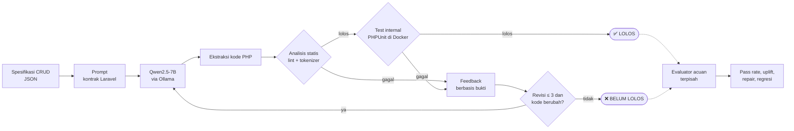

<div align="center">

# 🧐 Critic Agent

**Verifikasi deterministik untuk controller CRUD Laravel hasil LLM**

Critic Agent memeriksa controller REST API Laravel yang dibuat Qwen2.5-7B-Instruct, mengumpulkan bukti kegagalan dari analisis statis dan test Docker, lalu mengirim bukti itu kembali ke model untuk diperbaiki — maksimal tiga revisi.


[Cara kerja](#-cara-kerja) · [Mulai cepat](#-mulai-cepat) · [Perintah](#-daftar-perintah) · [Status](#-status-proyek) · [Dokumentasi](#-dokumentasi)

</div>

---

> [!NOTE]
> **Tugas Akhir D-III — Kelompok 3.** Dokumentasi ditulis dalam Bahasa Indonesia.

## 📌 Ringkasan

LLM kecil seperti Qwen2.5-7B sering menghasilkan controller yang *terlihat* benar tetapi gagal pada validasi, kode status, atau isolasi record. Critic Agent **tidak memakai LLM sebagai penilai**. Setiap putusan berasal dari bukti yang dapat diulang:

- 🔍 **Analisis statis** — lint PHP dan tokenizer untuk namespace, class, method, dan signature.
- 🐳 **Test dinamis** — PHPUnit di dalam container Docker dengan database SQLite baru tiap percobaan.
- 🔁 **Self-debugging** — feedback spesifik dikirim ke Qwen; loop berhenti saat lolos, kode identik, batas 3 revisi, atau ERROR.
- 📏 **Evaluator acuan terpisah** — suite independen yang tidak pernah masuk prompt atau feedback, untuk mengukur kualitas kode awal vs akhir.
- 🗂️ **Arsip lengkap** — spesifikasi, prompt, respons mentah, kode, hash, dan manifest tersimpan untuk setiap generasi, termasuk yang gagal.

## ⚙️ Cara kerja



| Status | Arti |
|---|---|
| `LOLOS` | Pemeriksaan statis bersih **dan** seluruh test internal lulus. |
| `BELUM LOLOS` | Masih ada kegagalan setelah 3 revisi, atau model mengirim kode identik. |
| `ERROR` | Masalah lingkungan/model (Docker, Ollama, timeout) — bukan kesalahan kandidat. |
| `AWAITING_DYNAMIC_TESTS` | Tahap fondasi selesai, test dinamis belum dijalankan. **Bukan** LOLOS fungsional. |
| `EVALUATED` | Evaluator acuan selesai menilai pasangan, termasuk bila ada test yang gagal. |

## 🚀 Mulai cepat

### Prasyarat

| Komponen | Keterangan |
|---|---|
| Python 3.11+ | Hanya standard library, tanpa `pip install`. |
| PHP | Untuk `analyze` (lint/tokenizer). Kandidat **tidak pernah** dieksekusi di PHP host. |
| Docker Desktop | Mode Linux/WSL2 pada Windows. Build image pertama memerlukan jaringan. |
| Ollama | Dengan model `qwen2.5:7b-instruct`. |

### Instalasi dan pengecekan

```powershell
git clone https://github.com/josuaajait/tugas_akhir_kel_3.git
cd tugas_akhir_kel_3
ollama pull qwen2.5:7b-instruct
python -m critic_agent doctor
```

### Jalankan mode interaktif

```powershell
python -m critic_agent start
```

Wizard menanyakan nama resource/tabel, model, controller, serta nama/tipe/batas/unique tiap field (`string` atau `integer`). Sistem menampilkan JSON untuk dikonfirmasi, menyiapkan harness Docker, lalu menjalankan Qwen dengan self-debugging maksimal tiga revisi. Tekan `n` atau Ctrl+C untuk membatalkan (exit code `130`).

### Contoh lain

```powershell
python -m critic_agent validate examples/products.json
python -m critic_agent prompt examples/products.json
python -m critic_agent run-resource examples/books.json --seed 42 --temperature 0.2
python -m unittest discover -s tests -v
```

> [!TIP]
> Tampilan berwarna aktif otomatis di terminal. Gunakan `--pretty` untuk memaksanya, `--json` untuk keluaran JSON murni, dan `--no-color` (atau `NO_COLOR`) untuk mematikan warna. Saat stdout dipipe, keluaran otomatis JSON sehingga bisa dibaca `ConvertFrom-Json`.

## 🧰 Daftar perintah

Jalankan `python -m critic_agent <perintah> --help` untuk opsi lengkap.

| Kelompok | Perintah | Fungsi |
|---|---|---|
| **Dasar** | `doctor` | Periksa Python, PHP, Docker, Ollama, dan model. |
| | `validate` · `prompt` | Validasi spesifikasi JSON; tampilkan prompt. |
| | `generate` · `analyze` | Panggil Qwen sekali; analisis statis controller. |
| **Loop** | `start` | Wizard interaktif end-to-end. |
| | `run-products` · `run-resource` | Loop revisi otomatis (maks. 3) untuk products atau resource lain. |
| **Harness** | `harness-build` · `harness-check` · `check-products` | Harness Docker products. |
| | `resource-build` · `resource-check` | Harness yang dibentuk dari spesifikasi JSON. |
| **Evaluator** | `evaluation-build` · `evaluate-products` · `reference-check-products` | Evaluator acuan products. |
| | `resource-evaluation-build` · `evaluate-resource` | Evaluator acuan books/inventory. |
| | `final-validate` | Validasi paket soal/evaluator berversi tanpa Qwen. |
| **Pilot** | `pilot-plan` · `pilot-run` · `pilot-metadata` · `pilot-report` | Eksperimen suhu/seed dan agregasinya. |
| **Komponen** | `component-corpus-init` · `component-evidence` · `component-run` · `component-report` | Precision/recall/FPR Critic per kode cacat. |
| **A/B** | `run-ab` | Pembanding feedback spesifik vs generik (development). |
| | `ab-smoke` · `ab-plan-check` · `ab-run` · `ab-report` | Integrasi, gerbang protokol, eksekusi slot, dan agregasi A/B final. |
| **Freeze** | `freeze-draft` · `freeze-check` | Manifest pembekuan berhash SHA-256. |

**Exit code:** `0` berhasil · `1` temuan statis/BELUM LOLOS · `2` input/file invalid · `3` prasyarat/layanan bermasalah · `130` dibatalkan.

## 📊 Status proyek

> [!IMPORTANT]
> Semua angka di bawah adalah hasil **development/formatif**. Review manusia, keputusan protokol, dan pembekuan (freeze) belum selesai, sehingga ini **belum** merupakan hasil akhir penelitian.

| Tahap | Status | Bukti |
|---|---|---|
| Loop self-debugging (FR-01–14) | ✅ Teruji live | Products 13/14 → 14/14 setelah 1 revisi; books 12/12 tanpa revisi; inventory 11/16 → 12/16 lalu berhenti karena kode identik. |
| Evaluator acuan (FR-15) | ✅ Teruji live | Products 31/33 → 33/33; books 35/35 → 35/35; inventory 51/57 → 53/57. [Rincian](evaluation/README.md) |
| Pilot suhu/seed (PRD §12.7) | ✅ 27/27 job | 21 LOLOS, 6 BELUM LOLOS (kode identik), 0 ERROR. |
| Evaluasi komponen (FR-17) | 🟡 Provisional | Sintetis TP6/FP0/TN2/FN2; Qwen formatif TP3/FP0/TN2/FN0. Label masih draf. |
| Paket evaluasi **final-v2** | 🟡 Tervalidasi, menunggu review | 5 soal, 113 kasus internal / 401 acuan, 331 mutasi; 712/712 observasi Docker sesuai harapan. [Rincian](evaluation/final-v2/README.md) |
| A/B feedback spesifik vs generik (FR-20) | 🟡 Tooling siap | Smoke sintetis EVALUATED; protokol 20 pasangan masih **BLOCKED**. |
| Freeze & evaluasi sumatif (M4) | ⏳ Tertahan | Menunggu review manusia, keputusan K2/P-06/P-07/FR-20, digest model, dan manifest FROZEN. |

### Langkah berikutnya

1. Review manusia atas paket final-v2 oleh dua reviewer berbeda.
2. Putuskan K2, P-06, P-07, dan FR-20; verifikasi digest/kuantisasi model.
3. Bekukan protokol, model, suite, dan image; lalu jalankan 20 pasangan A/B final.
4. Laporkan seluruh hasil, termasuk kegagalan dan retry.

## 🗂️ Struktur repositori

```text
critic_agent/        Paket Python: CLI, loop, analisis statis, client Ollama, evaluator, A/B
harness/             Harness Laravel + PHPUnit untuk test internal (Docker)
resource_templates/  Template test yang dibentuk dari spesifikasi resource
evaluation/          Evaluator acuan terpisah (products, books/inventory, final-v1, final-v2)
examples/            Spesifikasi contoh (products, books, inventory) dan fixture controller
corpora/             Korpus anotasi untuk evaluasi komponen
tests/               Unit & integration test Python
```

Folder `runs/`, `evaluations/`, `component-runs/`, `component-evidence/`, `builds/`, `work/`, `vendor`, dan `docs/` diabaikan Git. Image Docker, model, dan arsip mentah tidak ikut clone.

## 📚 Dokumentasi

| Dokumen | Isi |
|---|---|
| [PRD v1.3](PRD_Critic_Agent_v1.3.md) | Kebutuhan produk dan protokol evaluasi. |
| [Harness](harness/README.md) | Cara kerja test internal Docker. |
| [Evaluator acuan](evaluation/README.md) · [Resource](evaluation/resource-reference/README.md) | Suite acuan products, books, dan inventory. |
| [final-v1](evaluation/final-v1/README.md) · [final-v2](evaluation/final-v2/README.md) | Paket soal dan evaluator final. |

<details>
<summary><b>📖 Panduan penggunaan rinci</b></summary>

### Loop revisi dari kode awal yang sudah ada

```powershell
python -m critic_agent run-products examples/products.json --initial-run runs/<folder_run_awal>
```

Kode awal dibaca ulang tanpa mengubah arsip sumber; seed dan suhu harus cocok dengan arsip awal. Untuk eksperimen baru dari generasi awal:

```powershell
python -m critic_agent run-products examples/products.json --seed 42 --temperature 0.2 --max-revisions 3
```

Keluaran di `runs/..._loop_.../`: `initial_controller.php`, `final_controller.php` (bila ada), `history.json`, `run_manifest.json`, `run.log`, dan `attempts/0`–`attempts/3` berisi kode, respons, hasil statis/dinamis, prompt revisi, dan feedback.

### Evaluasi acuan awal vs akhir

```powershell
python -m critic_agent harness-build
python -m critic_agent harness-check
python -m critic_agent evaluation-build
python -m critic_agent evaluate-products runs/<folder_loop>
```

Kode awal dan akhir dinilai dengan suite/image yang identik di container dan database baru. Hasil di `evaluations/.../evaluation_result.json`: pembilang/penyebut, pass rate, uplift (poin persentase), serta indikator repair/regresi. Penyebut nol → `null` (N/A). Respons tanpa kode atau gagal sintaks mendapat 0 dengan alasan tercatat; masalah lingkungan menghasilkan ERROR.

### Resource lain (books, inventory)

```powershell
python -m critic_agent resource-build examples/books.json
python -m critic_agent resource-check examples/books.json
python -m critic_agent run-resource examples/books.json --seed 42 --temperature 0.2 --timeout 300
python -m critic_agent resource-evaluation-build examples/books.json --timeout 600
python -m critic_agent evaluate-resource runs/<folder_loop>
```

Readiness: products 21/21, books 27/27, inventory 46/46. Evaluator acuan: products 33, books 35, inventory 57 kasus.

### Paket final-v2

```powershell
python -m critic_agent final-validate --package final-v2 --local-only --output evaluations/final-v2-local
python -m critic_agent final-validate --package final-v2 --build --output evaluations/final-v2-validation
python -m critic_agent ab-smoke --package final-v2 --resource categories --scenario repair --output runs/ab-v2-synthetic
```

Selalu gunakan `--package final-v2` secara eksplisit; final-v1 dipertahankan sebagai arsip historis.

### Opsi umum

`--output`, `--model`, `--temperature`, `--seed`, `--timeout`, `--test-timeout`, `--build-timeout`, `--max-revisions`. Suhu `0.2` / seed `42` adalah default development, bukan konfigurasi penelitian final.

</details>

## 🛡️ Prinsip integritas

- Test dan hasil evaluator acuan **tidak pernah** masuk prompt atau feedback internal.
- Kandidat hanya dieksekusi di container Docker, tidak di PHP host.
- Aturan berhenti (maks. 3 revisi, kode byte-identik) tidak diubah untuk memperbaiki hasil.
- Kegagalan, retry, ERROR, dan revisi yang tidak lengkap tetap disimpan dan dilaporkan.
- Paket evaluasi diperbaiki lewat **versi baru** (mis. final-v1 → final-v2), bukan mengubah manifest/hash lama.

## 🔗 Referensi

- [Ollama Generate API](https://docs.ollama.com/api/generate)
- [PHP `token_get_all`](https://www.php.net/manual/en/function.token-get-all.php)
- [Laravel 12 Routing](https://laravel.com/docs/12.x/routing)
- Gaya terminal terinspirasi [PTerm](https://github.com/pterm/cli-template), diadaptasi ke Python standard library.
